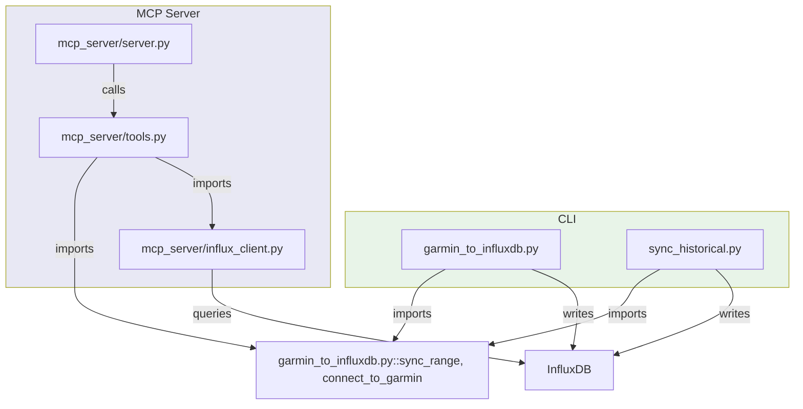

# garmin-influxdb -- Architecture

<!-- Purpose: High-level module map for contributors.
     Keep this SHORT. Only document things unlikely to change frequently.
     Revisit a couple times per year, not with every commit.
     Ref: matklad's ARCHITECTURE.md essay, architecture.md standard. -->

## Overview

Syncs Garmin Connect workout and daily-summary data to InfluxDB. Two CLI entry points handle live sync and historical backfill respectively; an optional MCP server exposes the same sync capability plus InfluxDB read queries to AI agents via the Model Context Protocol.

All writes flow through `sync_range` in `garmin_to_influxdb.py`. The MCP server reuses this function via `tools.sync_garmin`, so any behavior change to `sync_range` affects both paths simultaneously.

Key dependencies: `garminconnect` (Garmin API), `influxdb` (InfluxDB client), `fastmcp` (MCP server only).

## Codemap

### garmin_to_influxdb.py

Core ETL module. Contains `connect_to_garmin` (token-cached login), `sync_range` (date-range sync orchestrator), `sync_activities` (activity records), and `sync_day` (daily stats, sleep, HRV, steps). All write paths terminate here. Speed calibration multiplier 3.584392177 is stored here and must not be changed without Garmin app verification.

Key functions: `connect_to_garmin`, `sync_range`, `sync_activities`, `sync_day`.

### sync_historical.py

Weekly-batch orchestrator for backfilling years of historical data. Loads state from `sync_state.json` so interrupted runs can resume. Imports `connect_to_garmin` and `sync_range` from `garmin_to_influxdb.py` rather than reimplementing sync logic.

Key functions: `_week_chunks`, `_run_chunk`, `run`.

### mcp_server/server.py

FastMCP app with 5 tool handlers: `list_metrics`, `query_fitness_data`, `query_activities`, `delete_data`, `sync_garmin`. All tools delegate to `mcp_server/tools.py`. The server runs over stdio so it can be embedded in AI agent tool chains.

### mcp_server/tools.py

MCP business logic. Maintains a singleton `InfluxClient` and reuses `sync_range` for the write path. `sync_garmin` auto-selects start date from the latest data in InfluxDB if not given explicit dates.

Key functions: `_db_client`, `list_metrics`, `query_fitness_data`, `query_activities`, `delete_data`, `sync_garmin`.

### mcp_server/influx_client.py

InfluxDB client wrapper. Provides measurement discovery, scalar aggregation queries, activity logs, and deletion. Parses both ISO8601 absolute ranges (YYYY-MM-DD..YYYY-MM-DD) and InfluxDB relative ranges (e.g. 4w). Includes unit metadata for all known metrics.

Key type: `InfluxClient`. Key methods: `get_measurements`, `query_scalar`, `query_activities`, `delete_measurement_range`, `get_latest_timestamp`.

### mcp_server/garmin_sync.py

Dead code. An alternate sync class that is never imported by any active module. Do not reference or modify.

## Architectural Invariants

- All writes to InfluxDB flow through `sync_range` in `garmin_to_influxdb.py`
- The Garmin client is a plain `Garmin` instance from `garminconnect`; no wrapper or mock layer exists
- No code reads config from a file at runtime -- all configuration comes from environment variables or `.env`
- `InfluxClient` is a singleton within a running MCP server process; `_db_client()` lazily initializes it once
- `sync_state.json` is the only persisted state; it is never read by the MCP server or live-sync script

## Layer Boundaries

- **CLI / Library boundary:** `garmin_to_influxdb.py` is a script module (executable) and a library simultaneously. `sync_historical.py` and `mcp_server/tools.py` import from it without creating an abstraction layer.
- **MCP read / write boundary:** Read path (list_metrics, query_fitness_data, query_activities) goes through `InfluxClient`. Write path (sync_garmin) bypasses `InfluxClient` and calls `sync_range` directly with the raw `InfluxDBClient`.
- **External API boundary:** Garmin API is accessed through the `garminconnect` library only; no raw HTTP calls exist in the codebase.

## Cross-Cutting Concerns

- **Error handling:** Garmin API errors (connection, auth, rate-limit) are caught and re-raised as exceptions; MCP tools catch exceptions and return error dicts. CLI scripts log errors and continue where possible.
- **Configuration:** `.env` loaded manually in `sync_historical.py`; `garmin_to_influxdb.py` reads env vars directly via `os.getenv`.
- **Logging:** stdlib `logging` only; `logging.basicConfig` called once per entry point with identical format.
- **Testing:** No pytest suite. `test_e2e.py` is ad-hoc and requires Docker + real InfluxDB. `mcp_server/test_mcp_client.py` is gitignored.

<!-- Guidelines:
     - Keep the whole file under 150 lines
     - Name entities, don't link them
     - If a section doesn't apply, remove it rather than leaving it empty
     - Update this file when module boundaries change, not for every code change
-->
