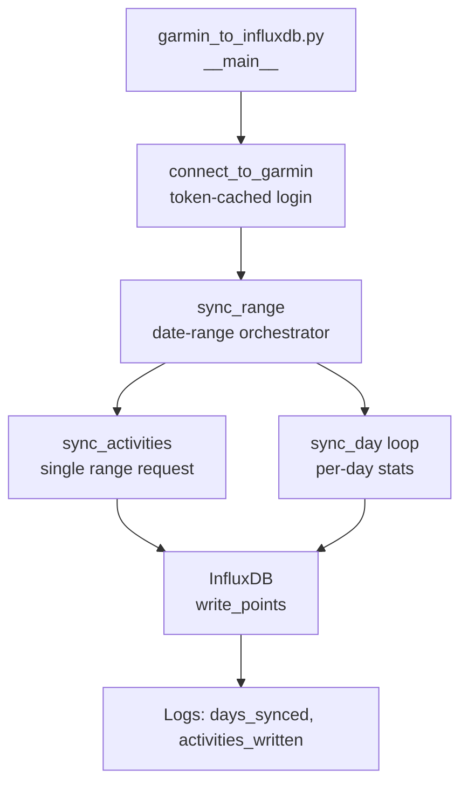
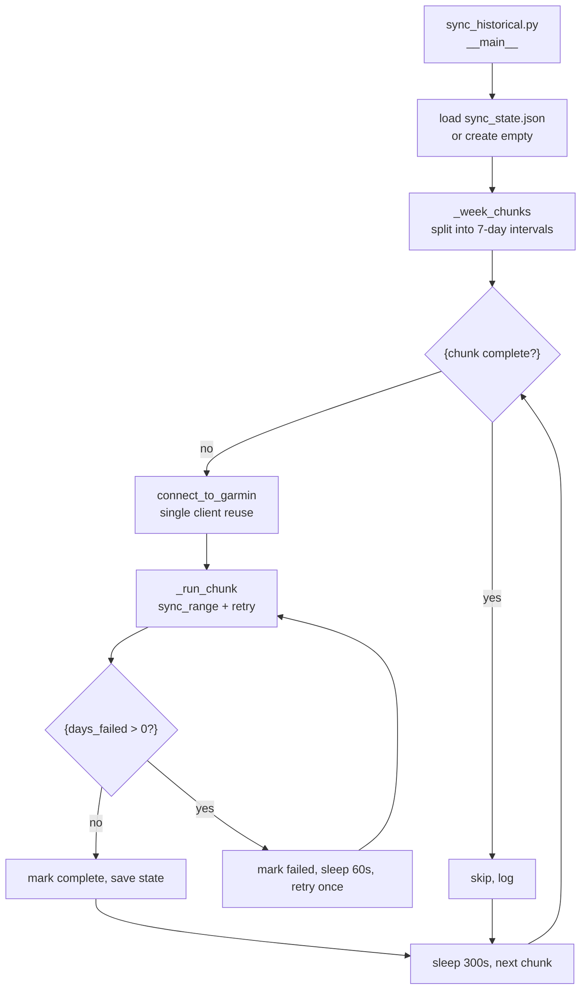
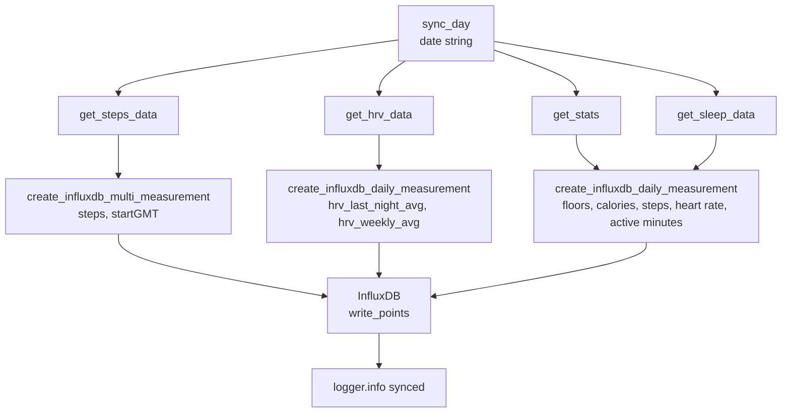
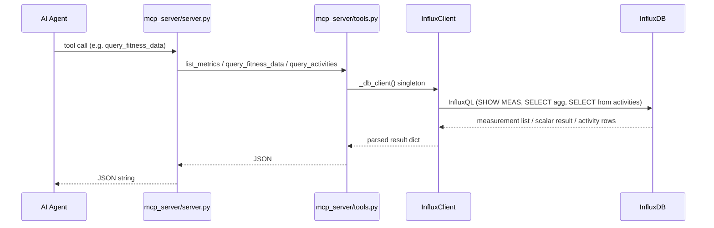
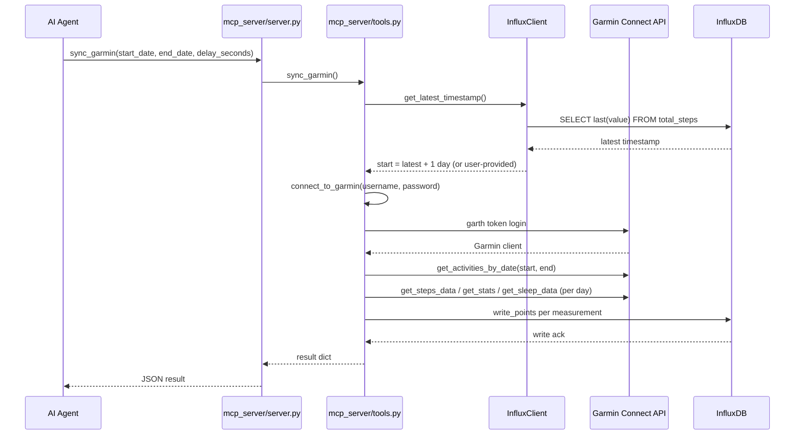
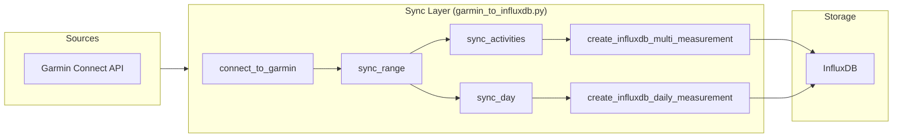
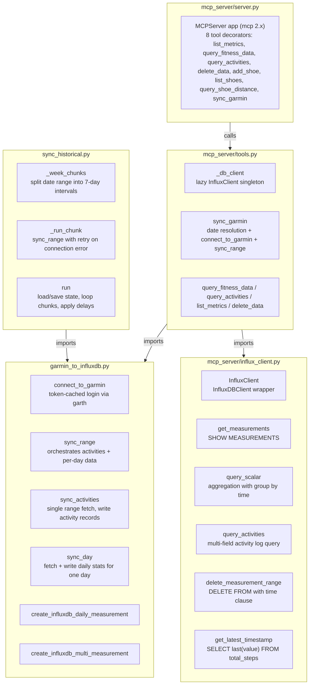

# garmin-influxdb -- Code Flow Documentation

<!-- Purpose: Visualize runtime data and control flow using Mermaid diagrams.
     Each section covers one major workflow or pipeline stage.
     Keep text minimal -- let the diagrams do the talking. -->

---

## Table of Contents

1. [One-Shot Sync Pipeline](#1-one-shot-sync-pipeline)
2. [Historical Backfill Orchestration](#2-historical-backfill-orchestration)
3. [Per-Day Sync Detail](#3-per-day-sync-detail)
4. [MCP Read Path](#4-mcp-read-path)
5. [MCP Sync Path](#5-mcp-sync-path)
6. [Complete Data Flow Summary](#6-complete-data-flow-summary)
7. [Key Modules and Responsibilities](#7-key-modules-and-responsibilities)

---

## 1. One-Shot Sync Pipeline

Entry: `python garmin_to_influxdb.py`. Syncs recent activities and daily stats for a hardcoded date range.

Note: `sync_range` is the universal write path shared by CLI, historical backfill, and MCP sync.

---

## 2. Historical Backfill Orchestration

Entry: `python sync_historical.py`. Splits date range into week chunks with state persistence.

---

## 3. Per-Day Sync Detail

`sync_day` fetches and writes all stats for a single calendar day.

---

## 4. MCP Read Path

Client calls one of: list_metrics, query_fitness_data, query_activities. No Garmin API involved.

---

## 5. MCP Sync Path

Client calls sync_garmin. Resolves date range, then calls connect_to_garmin + sync_range.

---

## 6. Complete Data Flow Summary

End-to-end: Garmin Connect API sources -> sync layer -> InfluxDB storage.

---

## 7. Key Modules and Responsibilities

---

<!-- Guidelines:
     - Each section = one logical workflow or pipeline stage
     - Prefer flowchart for pipelines, sequenceDiagram for service interactions
     - Keep annotations outside the diagram blocks (below, as brief notes)
     - Use subgraph blocks to group related steps
     - Name nodes descriptively: A["Parse Config"] not A["Step 1"]
-->
